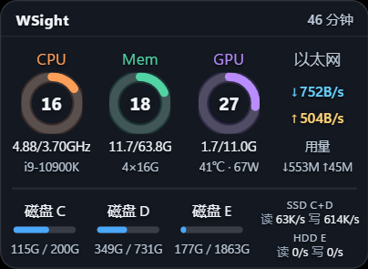
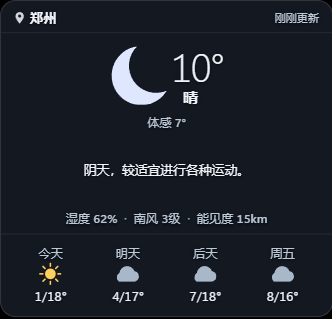
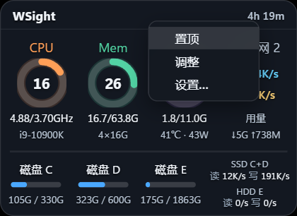
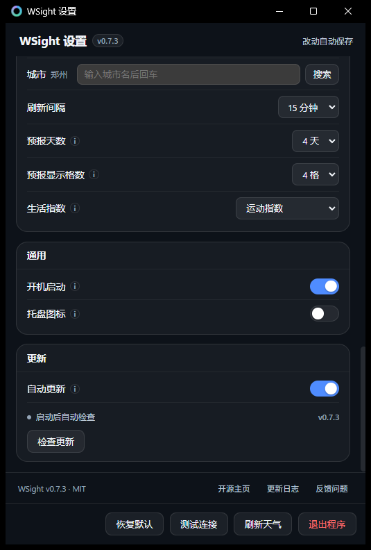

<div align="center">
  
  <h1>WSight</h1>
  <p><strong>Windows 桌面悬浮卡片 · 硬件监控 + 和风天气</strong></p>
  <p>
    <a href="https://github.com/WW-Ares/WSight/releases/latest"></a>
    
    
    
    
  </p>
</div>

---

WSight 把两块每天都要看的信息做成贴在桌面上的卡片：一块是 **CPU / 内存 / GPU / 网络 / 磁盘**的实时读数，一块是**和风天气**的实况与预报。Tauri 2 + React 18 + Rust，单个绿色 exe，常驻桌面但不打扰你正在用的窗口。

- **桌面家具，不是程序窗口。** 不进任务栏、不进 Alt+Tab，点它不会盖住你正在用的软件；按 `Win+D` 显示桌面也不会消失。
- **读数不糊弄。** CPU 实时频率走 PDH（`sysinfo` 在 Windows 上只会给额定频率）；读不到的量显示 `--`，不补 0 假装读到了。
- **自己换自己。** 绿色 exe，后台下载新版，下次启动自动完成替换，不需要安装包。
- **一切可调。** 主题、背景不透明度、圆角、环形配色、两张卡片的宽度、采样与刷新间隔；改完 450ms 防抖自动保存并立即生效。

## 界面截图

| 监控面板 | 天气面板 |
|---|---|
|  |  |

| 右键菜单 | 自动更新 |
|---|---|
|  |  |

## 功能

### 监控面板

四列竖排，每列一个圆环加两行数据：

| 列 | 内容 |
| --- | --- |
| CPU | 实时频率 / 额定频率、总占用率、最高核 / 最低核占用 |
| 内存 | 已用 / 总量、DDR 频率 |
| GPU | 占用率、显存已用 / 总量、温度 · 功耗（NVIDIA 走 NVML；其他厂商读型号与显存总量，占用率走 PDH） |
| 网络 | **真实网卡名**、实时上下行速率、累计上下行总量 |

圆环下方是磁盘块：左侧按**卷**显示容量占用（自选，最多 3 个），右侧按**物理硬盘**显示读写速度（自选，最多 2 块）。

每列的第二行内容可以在设置里逐列定制；不想看 GPU 环形或磁盘块，也可以整块关掉。

### 天气面板

- **实况**：温度、天气、体感、湿度、能见度，配和风天气图标。
- **预报**：3–7 天可调，每行 3–5 格，多出来的横向滚动。
- **生活指数**：和风天气 `/v7/indices/1d` 的 16 类指数任选（运动、穿衣、紫外线、交通、舒适度……），默认舒适度。
- **离线缓存**：断网或请求失败时继续显示上一次的数据，时间戳变灰；接口恢复后自动更新。

API Key 由使用者自己到[和风天气控制台](https://dev.qweather.com/)申请，程序不内置、不代申请。公共 API Host 或你的专属 Host 都可以。

### 设置与外观

| 分组 | 可调项 |
| --- | --- |
| 外观 | 深色 / 浅色、背景不透明度（只作用于卡片背景，文字与圆环始终全对比度）、圆角、监控窗宽度、天气窗宽度、环形与网速配色 |
| 监控 | GPU 环形开关、磁盘块开关、采样间隔、各列第二行内容 |
| 天气 | API Key、API Host、城市搜索、刷新间隔、预报天数、每行格数、生活指数类型 |
| 通用 | 开机启动、托盘图标开关 |
| 更新 | 自动更新开关、检查 / 重启更新、忽略当前版本、恢复提示 |

所有改动自动保存并立即应用到两个悬浮窗，不需要点确定。

### 悬浮窗行为

两张卡片默认**锁定**：不可拖动、不可缩放，避免误触。右键菜单选「调整」后才进入可拖动 / 缩放状态，窗口位置会记住。

- **永远在所有普通窗口下面。** 窗口带 `WS_EX_NOACTIVATE`，点击不会把它顶上来盖住你正在用的软件，点完还会自己沉回去。
- **不进任务栏、不进 Alt+Tab。** 用 `WS_EX_TOOLWINDOW`，StartAllBack 之类的任务栏美化工具重建任务栏时也不会把它收进去。
- **按 `Win+D` 不会消失。** 显示桌面时程序发现盖住自己的是桌面，就在同一帧把自己提到紧贴桌面上方；桌面收回时再跟着落回去。临时置顶只存在桌面显示的瞬间，不会压住正在用的软件。
- **拖拽友好。** 自己逐帧处理拖动（不让 Aero Snap 接管），贴屏幕边缘、两张卡片上下对齐都有磁吸；拖出屏幕的部分会在退出「调整」时按整窗夹回显示器内。

右键菜单只有三项：**置顶 / 调整 / 设置…**。托盘图标可选，关掉之后仍可以从右键菜单进设置；退出在设置窗口底部。

托盘菜单：显示 / 隐藏监控面板、显示 / 隐藏天气窗口、立即刷新天气、设置…、退出。

### 自动更新

启动 15 秒后查一次 GitHub 上的最新版本，之后每 6 小时一次，查到就在后台下载并核对 SHA-256。**下次启动自动装好**，不用管它；不想等就进设置点「重启更新」立刻换上。

不想升可以点「忽略这个版本」，它只压住这一个版本号，再发新版照样提醒；设置里有「恢复提示」可以撤销。自动更新整体可以关掉。

## 安装

### 方式一：下载 exe（推荐）

到 [Releases](https://github.com/WW-Ares/WSight/releases/latest) 下载 `WSight.exe`，放进一个**有写权限的文件夹**，双击运行。

- 单文件绿色版，不需要安装，不写开始菜单。卸载就是删掉 exe 和 `%APPDATA%\WSight`。
- 自更新会在 exe 同目录做「改名 → 替换」，所以**不要放在 `Program Files` 这类普通用户写不进去的目录**；目录不可写时会退到 `%APPDATA%` 再复制回来。
- 文件名建议保持 `WSight.exe`：更新暂存文件与 Release 附件都用这个固定名，目录可写时整个替换就是两次改名。

系统要求：Windows 10 / 11 x64，WebView2 Runtime（Windows 11 自带；Windows 10 一般随 Edge 已安装，缺失时装一次 Evergreen Runtime）。

### 方式二：源码构建

见下方[构建](#构建)。需要 Node 22+、pnpm、Rust 1.77+、WebView2 Runtime。

## 快速上手

1. **启动**：双击 `WSight.exe`，监控和天气两张卡片出现在桌面上（天气卡默认开启，可在设置里关）。
2. **摆位置**：右键卡片 →「调整」，拖动到想要的位置、拖边缘改大小；再点一次「调整」退出并锁定。两张卡片靠近时会自动磁吸对齐。
3. **配天气**：右键 →「设置…」→「天气窗口」，填入和风天气 API Key 和 API Host，搜索城市并选中，保存即生效。
4. **调外观**：同一窗口的「外观」里换主题、透明度、圆角、四个环的颜色和卡片宽度。
5. **托盘**：需要常驻托盘就在「通用」里打开「托盘图标」；不需要就关掉，右键菜单仍可进设置。
6. **退出**：设置窗口底部「退出程序」，或托盘菜单「退出」。

## 配置

配置文件在 `%APPDATA%\WSight\config.json`，一般通过设置窗口修改，不用手改。设置窗口每次改动都会写盘，手改文件可能在下次保存时被覆盖。

启动日志在 `%APPDATA%\WSight\launch.log`，按整行边界裁剪到 128 KB 以内。遇到双击没反应，先看这个文件。

## 实现细节

### 硬件读数

全部走系统调用，没有 PowerShell / WMI 轮询，也没有为此新增常驻进程：

- **CPU 实时频率**：`sysinfo` 在 Windows 上读的是 `CallNtPowerInformation` 的 `CurrentMhz`，**恒等于额定频率**（面板上那个数永远不动）。改用 PDH 计数器 `\Processor Information(_Total)\% Processor Performance` 乘额定频率，得到会随睿频变化的真实值。
- **内存频率**：`GetSystemFirmwareTable('RSMB')` 解析 SMBIOS type 17。这个 provider 签名是多字符常量，**必须按大端打包**（`'RSMB'` = `0x52534D42`），写成小端会返回 0 而被误判成「被系统拦截」。
- **卷 → 物理硬盘**：`IOCTL_STORAGE_GET_DEVICE_NUMBER`，不需要管理员权限。
- **磁盘吞吐**：`IOCTL_DISK_PERFORMANCE` 是按**卷**统计的，所以「某块物理硬盘的读写」要把该盘上所有分区相加（比如 C+D 同属一块 NVMe）。
- **显卡信息**：NVIDIA 走 NVML；其它厂商读注册表 `HardwareInformation.qwMemorySize` 拿型号与显存总量，实时占用率走 PDH `\GPU Engine(*)\Utilization Percentage`（和任务管理器同源）。**有多少说多少**：占用率读不到就显示 `--/11.0G`，不写 0。

采样线程只做读取和缓存，前端按自己的节奏取最新一帧，窗口隐藏时不空转。

### 桌面层级

「永远在普通窗口下面」和「`Win+D` 不消失」是两个互相拉扯的需求，做法不是把窗口钉死在栈底：

- 平时把窗口放在普通窗口之下；发现盖住自己的是**桌面**（用户按了 `Win+D`），才临时提到置顶层。
- 桌面收回时它会一路往栈底滑（约 110ms），程序用约 0.26 秒的短跟踪让自己始终贴在它正上方，抬起和落下两头都看不见闪。
- 判定「显示桌面」要求桌面真的占到窗口栈顶并复核一次，单纯点一下桌面不会被误判。
- 也试过 DeskBox 那套 `SetParent` 进桌面的做法：它会把窗口坐标系换成父窗口客户区，还要在 Explorer 重启时重挂一次，对已经成熟的拖拽 + 磁吸实现来说不划算。

### 自己换自己（无安装包更新）

WSight 是一个绿色 exe，更新靠替换自己。整个机制只立在一句话上：
**Windows 不允许覆盖正在运行的程序，但允许给它改名。**

```text
WSight.exe      -> WSight-old-0.5.0.exe
WSight.exe.new  -> WSight.exe
启动新的 WSight.exe --handover --replaced <旧文件>，自己退出
新的那个收尾：删掉多余的 WSight-old-*.exe，只留上一版
```

三个不显然的地方：

- **文件名固定不变。** 路径从头到尾没动，开机启动项、快捷方式、下一次更新说的都是同一个文件。因此 **Release 附件名必须一直是 `WSight.exe`**（`scripts/pack.mjs` 保证这点）。
- **新进程一开始是「重复实例」。** 单实例互斥量由旧进程握着，它必须死掉才能放。所以新进程带 `--handover` 启动，**等互斥量消失**再进场，而不是一看到「已有实例」就退出——否则更新完就什么都没有了。
- **上一版必须是个能双击运行的 `.exe`。** 新版本要是启不来，那一刻已经没有窗口可以给你点「回滚」，退路只能是文件本身。所以留下的叫 `WSight-old-<版本>.exe`，不是早期那个 Windows 不认的 `WSight.exe.old-*` 后缀。

下载会核对 GitHub 给出的 SHA-256（附件没有 `digest` 时只核对大小，界面上会写明「仅核对文件大小」，不假装校验过）。包放在 exe 同目录（跨盘改名不成立），目录不可写时才退回 `%APPDATA%` 再复制过去。

### 天气

和风天气接口返回 `Content-Encoding: gzip`，即使客户端没有声明也会压缩，所以 `reqwest` 必须开 `gzip` feature。实况和 7 天预报是必需数据，生活指数是尽力而为：指数接口失败时卡片照常显示，只是少一行建议。

## 读不到的东西（以及为什么不假装能读）

- **CPU 温度 / 功耗**：OS 层唯一来源是 WMI `MSAcpi_ThermalZoneTemperature`，本机热区被主板冻在 27.9℃（压到 63% 负载也纹丝不动）；真实功耗要读 MSR RAPL，需要内核驱动。
- **内存温度 / 功耗**：DDR4 没有温度传感器，SPD Hub 是 DDR5 才有的。
- **显存温度**：GDDR6 无此传感器。

所以 CPU 第二行给的是「最高核 / 最低核占用」，内存第二行给的是 DDR 频率——用能真实读到的量回答「是不是单核跑满了」这类问题，而不是编一个数字。

## 构建

前置：Node 22+、pnpm、Rust 1.77+、WebView2 Runtime。

```bash
pnpm install

pnpm build                        # tsc --noEmit + vite build
pnpm tauri build --no-bundle      # 只出 exe，不打安装包
pnpm dist                         # 复制成根目录的 WSight.exe 并打印 sha256
```

`--no-bundle` 不会按 `productName` 改名，`pnpm dist` 顺手做了这件事——名字必须是 `WSight.exe`（自更新按固定名替换），发布时也用它当附件名。

> **不要只用 `cargo build --release`。** Tauri CLI 才会开启 `custom-protocol` feature；缺少它时 `tauri-macros` 按 `dev: true` 编译，三个窗口会去连 `http://localhost:1420`，表现为「无法访问此页面 / ERR_CONNECTION_REFUSED」。

版本号在四处重复（`package.json`、`src-tauri/tauri.conf.json`、`src-tauri/Cargo.toml`、`src/shared/about.ts`），改完跑 `pnpm check:version` 校验；它还会检查 `dist/` 里已构建前端的版本号，防止把上一次的界面嵌进新 exe。

发布流程（打标签、Release 说明怎么由 `CHANGELOG.md` 派生）见 [docs/RELEASE.md](docs/RELEASE.md)。

## 目录

```text
src/
  monitor/            监控卡片：布局、圆环、采样缓存、第二行内容
  weather/            天气卡片：实况、预报格、图标、缓存状态
  settings/           设置窗口：外观 / 监控 / 天气 / 通用 / 更新
  shared/             主题、配置 hooks、窗口外壳、右键菜单、版本与链接
src-tauri/
  src/
    collector.rs      硬件采样（PDH / SMBIOS / IOCTL / NVML）
    desktop.rs        窗口层级、显示桌面跟随、拖动与磁吸
    updater.rs        检查、下载、校验、改名替换
    weather.rs        和风天气客户端与缓存
    config.rs         配置模型、默认值、落盘
    autostart.rs      开机启动（注册表 Run）
    single_instance.rs 单实例互斥量与 --handover 交接
    launchlog.rs      启动日志与裁剪
  icons/              应用图标
scripts/
  pack.mjs            构建产物改名 + sha256
  check-version.mjs   四处版本号 + dist 一致性校验
  release-notes.mjs   由 CHANGELOG 生成 Release 说明
docs/
  RELEASE.md          发布守则
  screenshot-*.png    README 截图
```

## 已知限制

- **CPU 温度 / 功耗、内存温度、显存温度**读不到，原因见上文；界面不会用占位数字冒充。
- **非 NVIDIA 显卡**只能读到型号和显存总量，实时占用率依赖 PDH 的 GPU Engine 计数器；读不到就显示 `--`。
- **自动更新需要能访问 GitHub**（`api.github.com` 与 release 下载域）。网络不通时不影响使用，只是检查失败；也可以直接关掉自动更新。
- **和风天气需要自己的 API Key**，免费额度与接口权限由和风天气控制；Key 失效时卡片保留上次数据并提示。
- **`Win+D` 的临时置顶由程序自己管理**，不是给窗口加常驻 `WS_EX_TOPMOST`；如果系统策略或第三方窗口管理器强行改变 Z 序，跟随可能失效。
- **项目只面向 Windows 10 / 11**，不提供 Linux / macOS 构建；窗口层级相关的代码也全部是 Win32。

## 更新日志

每个版本的改动、修复思路和踩过的坑都在 [CHANGELOG.md](CHANGELOG.md)。

## 贡献者

- [WW-Ares](https://github.com/WW-Ares) — 项目作者：设计、实现、发布与文档
- **Codex** — AI 结对开发：架构讨论、代码实现、桌面层级验证、构建脚本与 README 整理

欢迎提交 [Issue](https://github.com/WW-Ares/WSight/issues) 和 Pull Request。

## 许可

[MIT](LICENSE) © 2026 WW-Ares

## 致谢

- [Tauri](https://tauri.app/) / [React](https://react.dev/) / [Vite](https://vite.dev/)
- [sysinfo](https://github.com/GuillaumeGomez/sysinfo)、[nvml-wrapper](https://github.com/Cldfire/nvml-wrapper)
- [和风天气 QWeather](https://dev.qweather.com/)
- 所有开源依赖的作者
